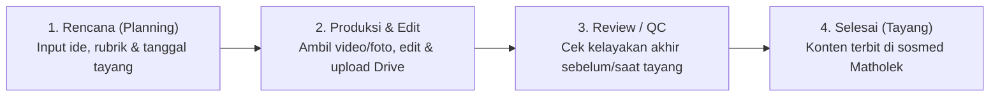

# Master Sistem Kerja UPM (Unit Pelayanan Media)
**Periode Khidmah 1447 H – 1448 H**  
*Dokumen Panduan Operasional & Alur Kerja Berbasis Kepemilikan Rubrik (End-to-End Rubric System)*

---

## 1. Latar Belakang & Perubahan Paradigma Kerja

Berdasarkan evaluasi dan keputusan rapat terakhir Unit Pelayanan Media (UPM), sistem kerja tim mengalami transformasi fundamental:

* **Sistem Lama (One-Gate Hirarki Struktural)**:  
  Pekerjaan dibagi secara terpisah berdasarkan fungsi teknis (satu orang khusus membuat konsep/naskah, orang lain mengambil video, orang lain mengedit, dan orang lain mengunggah). Sistem ini sering menimbulkan antrean (*bottleneck*) ketika salah satu tahap terhambat.
* **Sistem Baru (Kepemilikan Rubrik Mandiri / *End-to-End Rubric Ownership*)**:  
  Setiap staf inti diberikan tanggung jawab penuh sebagai **PIC (Person In Charge) Rubrik**. Tidak ada lagi pemisahan kaku antara siapa yang mengambil video, siapa yang mengedit, dan siapa yang memposting. **Setiap PIC bertanggung jawab penuh dari hulu ke hilir (*end-to-end*) atas konten pada rubriknya masing-masing.**

---

## 2. Target Utama & Beban Kerja

### A. Target Akun Utama (Matholek): *One Day One Post*
* Akun media sosial resmi Matholek menargetkan publikasi minimal **1 konten setiap hari (7 konten per pekan)**.
* Konten harus bervariasi mengikuti pembagian rubrik agar audiens mendapatkan sajian dakwah, informasi kelembagaan, dan konten kreatif yang seimbang setiap pekannya.

### B. Target Individu PIC Rubrik: *2 Post / Pekan*
* Setiap PIC Rubrik memiliki kuota wajib minimal **2 konten tayang dalam sepekan**.
* **Distribusi Kuota Mingguan**:
  * **Ziyan Firdaus** (*Dawuh & Keagamaan*): **2 Konten / Pekan**
  * **Vega Faisal Amri** (*Informasi Seputar Kemadrasahan*): **2 Konten / Pekan**
  * **Moh. Syihabuddin / Aab** (*Tren Sosmed*): **2 Konten / Pekan**
  * **Slot Hari ke-7 (1 Konten / Pekan)**: Diisi melalui konten kolaborasi tim, liputan agenda besar/insidental madrasah, atau giliran rubrik tematik.

---

## 3. Struktur Tim, Pembagian Rubrik & Wewenang

| Nama Personel | Jabatan / Peran | Rubrik Utama | Tanggung Jawab Operasional | Target Mingguan |
| :--- | :--- | :--- | :--- | :--- |
| **Ust. M. Zaim** | Penanggung Jawab | *Supervisi Eksekutif* | Pemantauan kinerja menyeluruh, arahan kebijakan, dan peninjauan kelayakan konten strategis. | Monitoring |
| **Ust. Ahmad Ismail** | Penanggung Jawab | *Supervisi Eksekutif* | Pemantauan kinerja menyeluruh, arahan kebijakan, dan peninjauan kelayakan konten strategis. | Monitoring |
| **Ainur Rofiq** | Ketua UPM | *Supervisi & Quality Control* | Koordinasi lintas rubrik, pemantauan kalender tayang harian, persetujuan QC, dan evaluasi target. | Supervisi Harian |
| **Faridu Asrih** | Ketua UPM | *Supervisi & Quality Control* | Koordinasi lintas rubrik, pemantauan kalender tayang harian, persetujuan QC, dan evaluasi target. | Supervisi Harian |
| **Ziyan Firdaus** | Staf Inti (PIC Rubrik) | **Dawuh & Keagamaan** | Merencanakan ide, mengambil video/visual, mengedit, dan memposting konten petuah masyayikh, kajian kitab, fiqih, tauhid, dan keislaman. | **2 Post / Pekan** |
| **Vega Faisal Amri** | Staf Inti (PIC Rubrik & Admin) | **Informasi Kemadrasahan** | Merencanakan ide, mengambil video/visual, mengedit, dan memposting informasi akademik, kegiatan siswa, pengumuman, profil, serta administrasi UPM. | **2 Post / Pekan** |
| **Moh. Syihabuddin (Aab)** | Staf Inti (PIC Rubrik) | **Tren Sosmed** | Merencanakan ide, mengambil video/visual, mengedit, dan memposting konten kreatif berbasis tren terkini yang relevan dengan nilai madrasah. | **2 Post / Pekan** |

---

## 4. Cakupan Materi Per Rubrik

### 1. Rubrik Dawuh & Keagamaan — *PIC: Ziyan Firdaus*
* **Fokus**: Nilai spiritual, keilmuan pesantren/madrasah, dan pesan hikmah dari para Masyayikh / Guru.
* **Format & Ide Konten**:
  * Cuplikan video / *reels* pengajian atau tausiyah Masyayikh.
  * Desain kutipan (*quote card* / *carousel*) Dawuh Guru.
  * Edukasi singkat Fiqih harian, Tauhid, Akhlak, atau kajian Kitab Kuning.
  * Konten peringatan hari besar Islam (PHBI) & amalan sunnah.

### 2. Rubrik Informasi Seputar Kemadrasahan — *PIC: Vega Faisal Amri*
* **Fokus**: Wajah kelembagaan, informasi resmi, prestasi, dan aktivitas harian di lingkungan madrasah.
* **Format & Ide Konten**:
  * Liputan kegiatan madrasah, ujian, ekstrakurikuler, dan acara resmi.
  * Pengumuman akademik, kalender pendidikan, dan informasi layanan madrasah.
  * Profil fasilitas, prestasi santri/siswa, serta dokumentasi tamu atau kemitraan (*partnership*).
  * Pengelolaan tugas administrasi dan inventaris UPM.

### 3. Rubrik Tren Sosmed — *PIC: Moh. Syihabuddin (Aab)*
* **Fokus**: Menjangkau audiens luas dan generasi muda melalui adaptasi tren media sosial yang santun, kreatif, dan edukatif.
* **Format & Ide Konten**:
  * Video pendek (*Reels / TikTok / Shorts*) adaptasi audio atau format tren terkini.
  * *Mini-vlog*, wawancara singkat (*vox pop*) santri/guru, atau *behind the scenes* kehidupan madrasah.
  * Konten interaktif, kuis ringan, atau *storytelling* keseharian di Matholek.

---

## 5. SOP Alur Kerja 4 Tahap (End-to-End di Aplikasi Dashboard UPM)

Meskipun setiap PIC mengerjakan kontennya secara mandiri dari awal hingga akhir, pencatatan di aplikasi **Dashboard Kinerja UPM** tetap melewati **4 tahapan status** agar progres, arsip Google Drive, dan jadwal *One Day One Post* terpantau secara transparan:

### Tahap 1: Rencana (`planning`)
1. PIC membuka menu **Buat Tugas (`+ Buat`)** di aplikasi.
2. Sistem otomatis memilih nama PIC dan rubrik bawaannya.
3. PIC mengisi **Judul Konten**, memilih **Target Tanggal Tayang (`Publish Date`)** agar muncul di Kalender Bulanan, serta menuliskan poin konsep/ide singkat.
4. Tugas masuk ke daftar rencana dan kalender tayang.

### Tahap 2: Produksi & Editing (`produksi`)
1. PIC melakukan pengambilan gambar/video (*shooting*) dan penyuntingan (*editing*) secara mandiri.
2. Setelah file video/desain selesai diedit, PIC membuka halaman detail tugas dan mengunggah file hasil akhir ke **Google Drive** melalui zona unggah di aplikasi (atau melampirkan tautan/catatan hasil).
3. Sistem otomatis menyimpan file ke dalam folder Google Drive sesuai struktur:  
   `SISTEM DASHBOARD UPM / [Periode Hijriyah] / [Bulan] / Grade [S/A/B/C] / [Judul Konten]`
4. PIC menekan tombol **Selesaikan Produksi & Lanjut ke Review/QC**.

### Tahap 3: Review / Quality Control (`qc`)
1. Konten yang telah diunggah masuk ke tahap pengecekan akhir.
2. **Ketua UPM** (atau PIC terkait setelah koordinasi) memeriksa kelayakan visual, audio, dan kesesuaian teks/*caption*.
3. Jika ada catatan perbaikan, status dapat dikembalikan ke tahap Produksi beserta komentar revisi.
4. Jika sudah layak tayang dan diposting ke akun Matholek, tekan **Setujui & Tandai Selesai (Tayang)**.

### Tahap 4: Selesai / Tayang (`selesai`)
1. Konten resmi terpublikasi di akun media sosial Matholek.
2. Sistem otomatis:
   * Menambahkan **+1 pada capaian Target Mingguan PIC** (`WeeklyTracker`).
   * Mengurangi sisa beban pada **Target Program Kerja Tahunan (`Progja`)**.
   * Menandai jadwal di **Kalender Tayang Bulanan** dengan indikator hijau (Selesai).

---

## 6. Standar Grade Konten & Perhitungan Beban Kerja

Untuk menjaga keadilan beban kerja antara konten ringan dan produksi berat, setiap tugas memiliki klasifikasi **Grade**:

| Grade | Kategori Kesulitan | Contoh Format Konten | Bobot Poin |
| :---: | :--- | :--- | :---: |
| **Grade S** | Produksi Besar / Spesial | Film dokumenter, video profil utama, liputan event akbar multi-kamera. | **5 Poin** |
| **Grade A** | Produksi Reguler Utama | Video Reels/TikTok terkonsep (Dawuh, Tren Sosmed, Liputan Madrasah), Podcast. | **3 Poin** |
| **Grade B** | Konten Visual Menengah | Desain Carousel edukasi (4–12 slide), poster informasi utama. | **2 Poin** |
| **Grade C** | Konten Cepat / Harian | Desain Story, pengumuman singkat, repost terkurasi, dokumentasi ringan. | **1 Poin** |

---

## 7. Evaluasi & Pemantauan Rutin

1. **Pantauan Harian (Kalender Tayang)**:  
   Ketua UPM dan seluruh PIC memastikan tidak ada hari yang kosong (*bolong*) pada menu **Kalender Tayang** demi menjaga konsistensi *One Day One Post*.
2. **Pantauan Mingguan (Target 2 Post / Pekan)**:  
   Kartu **Target Mingguan** di halaman Beranda mereset perhitungan setiap hari Senin pukul 00:00 WIB dan menampilkan progres `0/2`, `1/2`, hingga `2/2` untuk Ziyan, Vega, dan Aab.
3. **Pantauan Bulanan & Tahunan (Periode Hijriyah)**:  
   Seluruh rekapitulasi kinerja mengacu pada kalender kerja Hijriyah (**12 Syawal – 25 Sya'ban**) yang dapat dipantau secara terbuka oleh Penanggung Jawab dan Ketua UPM.
